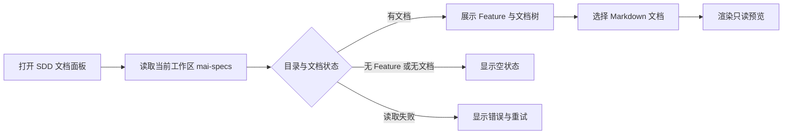

# PRD：mai-sdd-doc-viewer DSH 插件

> 状态：草稿（待评审） | 负责人：待填 | Profile：standard
>
> 模板：[PRD.tmpl.md](../../_templates/PRD.tmpl.md) | 有效需求与验收维护源：本文；初始输入为 [BRIEF](../BRIEF.md) 及本次用户确认的五项要求。

[返回需求简报](../BRIEF.md)

## 1. 背景与目标（Why）

- **背景/痛点**：my-ai-infra 将 Feature 的 BRIEF、PRD、技术设计、评审和测试等 SDD 产物分布在 `mai-specs/NNN-slug/` 中。DSH 已有通用工作区文件导航和 Markdown 文档预览，但用户仍需逐层查找目录，缺少按 Feature 聚合 SDD 文档的专用入口。
- **目标**：在 DSH Web 右侧 Sidebar 提供只读的 SDD 文档面板，使用户能够按 Feature 浏览并预览仓库 `mai-specs` 中的 Markdown 产物；同时交付符合课程约束的 Cordis 插件及完整 SDD 过程记录。
- **成功指标**：在未配置任何 LLM API Key 的 DSH Web 环境中，用户能够从专用入口找到当前工作区任一 Feature 的 Markdown 文档并看到渲染后的内容；浏览过程不修改文档、不执行 SDD 命令、不发起 LLM API 调用。

## 2. 用户与场景（Who / When）

| 用户故事 ID | 目标用户 | 触发场景 | 用户故事：作为…我希望…以便… | 关联需求 |
|---|---|---|---|---|
| US-01 | SDD 开发者、课程学生 | 需要查阅某个 Feature 的过程产物 | 作为 SDD 开发者，我希望在 DSH Web 中按 Feature 展开文档树，以便快速定位 BRIEF、PRD、设计、评审和测试文档。 | FR-01、FR-02、FR-03 |
| US-02 | 规格评审者 | 已找到一篇 Markdown 规格文档 | 作为评审者，我希望直接阅读渲染后的 Markdown，以便核对标题、列表、表格、代码块和正文内容。 | FR-04 |
| US-03 | SDD 开发者、规格评审者 | 文档在编辑器或其他工具中发生变化，或读取暂时失败 | 作为文档读者，我希望手动重新读取并看到明确的空态或错误反馈，以便获得当前内容并恢复阅读。 | FR-05、FR-06 |
| US-04 | 课程教师、作业评审者 | 检查插件和 SDD 作业交付 | 作为作业评审者，我希望核对插件必备文件、全部中间产物和作业说明，以便确认交付符合课程约束。 | FR-07、FR-08 |

## 3. 总体业务流程

### BF-01：浏览并预览 SDD 文档

**参与者与起止**：用户在已连接工作区的 DSH Web 中打开“SDD 文档”入口；流程以看到 Markdown 预览结束，或以可恢复的空态、错误提示结束。



**流程说明**：入口和目录发现遵循 FR-01、FR-02；用户展开节点并选择文档后，系统按 FR-03、FR-04 显示当前路径和渲染内容。重新读取及失败恢复遵循 FR-05、FR-06；全流程只读，并受 BR-01 至 BR-04 约束。

## 4. 功能需求（What）

### 4.1 新增需求

| 需求编号 | 触发条件 | 输入 | 预期行为 | 输出/结果 | 关联需求编号 |
|---|---|---|---|---|---|
| FR-01 | 插件已在 DSH Web 启用，用户打开右侧 Sidebar | 无 | 在现有引导入口中新增“SDD 文档”入口和插件图标；激活后打开专用面板，不覆盖插件管理、通用文件页等既有入口。 | 可见且可聚焦的“SDD 文档”入口；右侧显示专用面板。 | US-01、BR-06 |
| FR-02 | 用户打开面板或重新读取 | 当前会话工作区 | 以当前工作区根目录下的 `mai-specs` 为唯一文档根，列出直接子级中符合 `NNN-slug` 的 Feature 目录，并递归发现其中全部 `.md` 文件；根目录 README、ROADMAP、`_templates`、非 Feature 目录和非 Markdown 文件不进入文档树。没有 Markdown 的 Feature 仍显示其节点和空态。 | 按 Feature 聚合的文档树；无工作区、无根目录或无文档时显示对应状态。 | US-01、BR-01、BR-02、BR-05 |
| FR-03 | 文档树已显示，用户操作 Feature、子目录或文档节点 | 鼠标或键盘操作 | Feature 和子目录支持展开、折叠；首次展示展开 Feature 层、折叠更深层目录。文档节点显示相对路径并支持选择，当前文档在树中保持可见的选中状态；展开状态和选中状态在当前面板使用期间保留。 | 可浏览的层级树；当前 Feature、文档及其相对路径明确可辨。 | US-01、BR-05 |
| FR-04 | 用户选择一篇 Markdown 文档 | 文档完整路径 | 在同一右侧 Sidebar 工作流中显示文档相对路径和只读渲染预览，正确呈现标题、段落、列表、表格、链接及代码块；导航与预览之间始终存在可见的切换途径，不调用外部应用。 | 当前文档的渲染内容和路径；未选择文档时显示选择提示。 | US-02、BR-03 |
| FR-05 | 用户点击“重新读取” | 当前工作区及可选的当前文档 | 重新发现 Feature 和文档，并重读当前文档；保留仍有效的展开与选中状态。当前文档仍可读时展示新内容；已删除时清除失效预览并提示重新选择。 | 更新后的文档树或当前内容；失效选择有明确反馈。 | US-03 |
| FR-06 | 面板或文档处于加载、空态或读取失败状态 | 系统读取结果；用户可触发重试 | 分别展示加载、无工作区、无 `mai-specs`、无 Markdown、未选择文档和读取失败状态；失败不得伪装成空结果，错误状态提供“重试”操作。 | 与 COPY-01 至 COPY-10 一致的本地化反馈和恢复路径。 | US-03、NFR-03 |
| FR-07 | 课程作业进行插件交付检查 | 仓库文件 | 插件全部源码与清单位于 `plugins/mai-sdd-doc-viewer/`，至少包含本 PRD 第 8 节列出的六个必备文件，并可按 DSH + Cordis 插件方式加载。 | 完整、可检查的插件目录。 | US-04 |
| FR-08 | 课程作业最终交付 | Feature 产物及根目录说明 | 保留 Feature 999 已产生和后续产生的全部 SDD 中间产物，随插件代码一并纳入版本库；在根目录 `README.zh.md` 增加课程作业说明段落。 | 可随代码提交的 SDD 证据链及作业说明。 | US-04、BR-07 |

### 4.2 变更需求

无。本需求新增专用入口和只读聚合视图，不改变现有会话、通用文件导航、文档预览、插件管理或模型配置的业务规则。

## 5. UI 视觉与交互（按需）

### UI-01：SDD 文档侧边面板

**设计依据**：以下为拟议低保真线框，仅确定信息层级和操作，不代表已渲染的高保真设计。现状依据为已核验的[工作区文件导航](../../../packages/client/ui-sidebar-files/README.zh.md)和[Markdown 文档预览](../../../packages/client/ui-sidebar-documentpreview/README.zh.md)；颜色、图标、间距、停靠与窄屏行为沿用 DSH 现有 Sidebar 和设计令牌。

```text
┌──────────────────────────────────────────────┐
│ SDD 文档                          [重新读取] │
├──────────────────┬───────────────────────────┤
│ Feature / 文档   │ 999-mai-sdd-doc-viewer/…  │
│ ▾ 999-…          │                           │
│   BRIEF.md       │ # 渲染后的 Markdown 标题  │
│   ▾ spec         │ 正文、列表、表格与代码块  │
│     PRD.md  当前 │                           │
└──────────────────┴───────────────────────────┘
```

| 页面区域/控件 | 新增/变更 | 对照设计的功能与交互说明 | 关联需求 |
|---|---|---|---|
| Sidebar 引导入口 | 新增 | 显示插件图标和“SDD 文档”；支持鼠标、键盘激活及清晰焦点，激活后打开或聚焦专用面板。 | FR-01、NFR-02 |
| 面板头部 | 新增 | 显示“SDD 文档”和“重新读取”；重新读取期间显示进行状态，避免重复触发相互覆盖的结果。 | FR-05、FR-06 |
| Feature/文档导航区 | 新增 | 展示可展开的树、文档相对路径、当前选中项及空态；宽面板可与预览并排，窄面板沿用 DSH 导航开关或覆盖式导航，选择后能够到达预览。 | FR-02、FR-03、NFR-02 |
| Markdown 预览区 | 新增 | 显示当前文档路径、渲染正文、加载或错误反馈；只读，不提供编辑、保存、删除或执行操作。 | FR-04、FR-06、BR-03 |

**状态与反馈**：默认状态显示文档树和 COPY-07；加载状态显示 COPY-03；无工作区、缺少根目录、无文档和读取失败分别使用 COPY-04、COPY-05、COPY-06、COPY-08。重试或重新读取后回到加载状态，成功则显示内容，仍无结果则显示对应空态。所有图标按钮具有可访问名称，键盘焦点不因刷新或布局变化无故丢失。

## 6. 业务规则与约束（Rules）

| 规则 ID | 业务规则、状态流转、权限或数据约束 | 关联需求 |
|---|---|---|
| BR-01 | 文档根固定为当前会话工作区的 `mai-specs`；插件不得借此读取工作区之外的位置。没有当前工作区时不猜测或回退到其他目录。 | FR-02、FR-06 |
| BR-02 | Feature 是 `mai-specs` 直接子级中符合 `NNN-slug` 的目录；纳入其递归范围内的全部 `.md` 文件，包括 BRIEF、context、spec、design、test、review 等位置的产物。根级文档、模板和非 Markdown 素材不属于本面板目录。 | FR-02 |
| BR-03 | 面板只读。插件不得新增、修改、移动或删除规格文档，不提供编辑、保存、命令执行或 Git 操作；文档的外部变更由用户通过重新读取获取。 | FR-04、FR-05 |
| BR-04 | 插件本身不得执行 `mai` 或其他 SDD 命令，不得发起 LLM API 调用，不得要求或读取 LLM API Key，也不得把浏览内容注入模型请求、提示词、工具或会话事件。允许使用 DSH 已有的工作区只读文件能力和 Markdown 渲染能力。 | FR-01 至 FR-06、NFR-01 |
| BR-05 | Feature 节点按目录名自然升序；每层目录优先于文件，随后按名称自然升序；文档身份使用完整路径而非 basename。排序和选中状态不受界面语言影响。 | FR-02、FR-03、FR-04 |
| BR-06 | 新入口不得替换或禁用现有 Sidebar 入口；未选择文档或读取失败不得影响会话和其他面板。 | FR-01、FR-06、NFR-04 |
| BR-07 | SDD 产物随实际阶段持续保留，不因后续阶段覆盖、重构或评审而删除任何已产出的中间产物；需要更新时按流程保留有效历史与人工批注。版本库提交由开发者完成，插件不自动提交。 | FR-08 |

| 非功能 ID | 性能、可靠性、安全或可访问性要求 | 适用条件与验证口径 |
|---|---|---|
| NFR-01 | 在未设置任何 LLM API Key 的环境中可加载和使用全部本插件功能；运行期无 SDD 子进程、LLM 请求和凭据读取。 | 通过无 Key 的 DSH Web 组合启动及命令、模型请求观察验证。 |
| NFR-02 | 入口、树、重新读取、重试和预览导航支持键盘操作、可见焦点和可访问名称；窄面板下仍能到达导航与预览。 | 键盘-only 人工验收与目标 Web 端组件测试；不以鼠标悬停作为唯一信息入口。 |
| NFR-03 | 所有新增用户可见文字进入 DSH 类型化本地化字典，至少提供中文和英文；英文采用 sentence case，路径、ID 和文档内容保持原文。 | 切换 zh/en 检查界面、状态文字和可访问名称；静态检查无硬编码产品文案。 |
| NFR-04 | 插件卸载或禁用时移除自身入口和状态，不留下全局单例或改写其他插件状态；既有文件页和 Markdown 预览保持可用。 | 在真实 DSH Web 组合中启用、禁用插件并核对既有行为。 |

## 7. 范围与边界（Scope）

- **包含**：FR-01 至 FR-06 的侧边入口、Feature/Markdown 树、只读预览、手动重新读取、状态反馈和键盘中英文交互；FR-07 的插件必备文件；FR-08 的 SDD 产物保留及根目录作业说明。
- **不包含**：执行或封装 `mai`/SDD 命令；新建、编辑、删除或提交文档；LLM 总结、问答、检索增强或 API Key 配置；全文搜索和自定义排序；非 Markdown 格式转换；自动 Git 提交；Mermaid 图形化等超出既有 Markdown 预览能力的扩展渲染。
- **依赖**：DSH Web 当前会话已连接包含 `mai-specs` 的工作区；现有右侧 Sidebar、工作区只读文件访问和 Markdown 预览能力可用。上述依赖不得引入 LLM 或 API Key 前置条件。

## 8. 研发资源（按需）

| 资源 ID | 类型 | 实际链接/路径或本文位置 | 用途/关联需求 | 确认与核验状态 |
|---|---|---|---|---|
| RES-01 | 初始需求 | [BRIEF](../BRIEF.md) | 背景、插件位置及课程约束；FR-01 至 FR-08 | 已读取，用户确认 |
| RES-02 | 现有 UI 行为 | [工作区文件导航](../../../packages/client/ui-sidebar-files/README.zh.md) | Sidebar 树、导航、键盘与窄屏参考；FR-02、FR-03、NFR-02 | 已读取现有文档 |
| RES-03 | 现有 UI 行为 | [Markdown 文档预览](../../../packages/client/ui-sidebar-documentpreview/README.zh.md) | 只读渲染、加载、错误和刷新参考；FR-04 至 FR-06 | 已读取现有文档及 Markdown 注册代码 |
| RES-04 | 插件交付目录 | `plugins/mai-sdd-doc-viewer/` | 插件唯一输出位置；FR-07 | 用户确认，待后续实现 |
| RES-05 | SDD 证据目录 | `mai-specs/999-mai-sdd-doc-viewer/` | 保存本 Feature 全部中间产物；FR-08 | 已建立，持续保留 |
| RES-06 | 作业说明位置 | [README.zh.md](../../../README.zh.md) | 根目录课程作业说明；FR-08 | 已读取，待后续实现阶段修改 |

### 插件必备清单

| 文件 | 用途 | 关联需求 |
|---|---|---|
| `plugins/mai-sdd-doc-viewer/package.json` | 声明插件包元数据、入口和 DSH/Cordis 加载信息。 | FR-07 |
| `plugins/mai-sdd-doc-viewer/cordis.patch.yml` | 声明插件在 Cordis 组合中的插入配置。 | FR-07 |
| `plugins/mai-sdd-doc-viewer/client.js` | 提供浏览器侧入口，注册 Sidebar 面板及只读展示行为。 | FR-01 至 FR-07 |
| `plugins/mai-sdd-doc-viewer/icon.svg` | 提供插件管理信息和 Sidebar 入口使用的图标。 | FR-01、FR-07 |
| `plugins/mai-sdd-doc-viewer/README.zh.md` | 说明插件用途、使用方式、限制和无模型副作用。 | FR-07、BR-04 |
| `plugins/mai-sdd-doc-viewer/README.md` | 提供与中文说明一致的英文插件文档。 | FR-07、BR-04 |

### 最终文案（按需）

| 文案 ID | 位置/触发状态 | 中文最终文字 | 英文最终文字 |
|---|---|---|---|
| COPY-01 | Sidebar 入口及面板标题 | SDD 文档 | SDD documents |
| COPY-02 | 手动刷新按钮及可访问名称 | 重新读取 | Reload |
| COPY-03 | 目录或文档加载中 | 正在读取 SDD 文档... | Loading SDD documents... |
| COPY-04 | 当前会话没有工作区 | 请先打开一个包含 mai-specs 的工作区。 | Open a workspace containing mai-specs first. |
| COPY-05 | 工作区缺少根目录 | 当前工作区未找到 mai-specs 目录。 | No mai-specs directory was found in this workspace. |
| COPY-06 | 没有 Feature 文档或某 Feature 无 Markdown | 未找到可预览的 Markdown 文档。 | No Markdown documents were found. |
| COPY-07 | 尚未选择文档 | 请选择一篇 Markdown 文档。 | Select a Markdown document. |
| COPY-08 | 目录或文档读取失败 | SDD 文档读取失败，请重试。 | Failed to read SDD documents. Try again. |
| COPY-09 | 读取失败恢复按钮 | 重试 | Retry |
| COPY-10 | 重新读取后发现当前文档已删除 | 所选文档已不存在，请重新选择。 | The selected document no longer exists. Select another document. |

## 9. 验收标准（Acceptance Criteria）

### AC-01：无 API Key 启动并进入面板

**关联**：FR-01、FR-07、BR-04、BR-06、NFR-01

- **Given**：插件六个必备文件齐全，DSH Web 组合已启用插件，运行环境未设置任何 LLM API Key。
- **When**：启动 DSH Web 并用键盘激活“SDD 文档”入口。
- **Then**：插件加载成功，右侧显示专用面板和“重新读取”控件；没有 API Key 配置引导、SDD 命令执行或 LLM API 请求，现有 Sidebar 入口仍可使用。
- **验证方式**：静态清单检查；无 Key 的真实 Web 组合启动；浏览器人工操作及命令、模型请求观察。

### AC-02：按 Feature 发现并排序 Markdown

**关联**：FR-02、FR-03、BR-01、BR-02、BR-05

- **Given**：当前工作区包含 `mai-specs/999-alpha/BRIEF.md`、`mai-specs/999-alpha/spec/PRD.md`、`mai-specs/998-beta/design/TECH_DESIGN.md` 和空目录 `mai-specs/997-empty/`，另有 `998-beta/notes.txt`、根级 README/ROADMAP、`_templates/PRD.tmpl.md` 和一个非 Feature 目录。
- **When**：用户打开面板。
- **Then**：树仅显示上述三篇 `.md`，并按 Feature 和目录规则排序；998-beta 位于 999-alpha 之前，Feature 层默认展开；模板、根级文档、文本文件和非 Feature 目录均不出现，空 Feature 显示 COPY-06。
- **验证方式**：使用确定性工作区 fixture 的组件或 Web 测试，核对树节点、顺序和默认展开状态。

### AC-03：渲染只读 Markdown 预览

**关联**：FR-03、FR-04、BR-03

- **Given**：文档树中存在包含多级标题、列表、表格、链接和代码块的 Markdown 文档。
- **When**：用户通过鼠标及键盘分别选择该文档。
- **Then**：预览显示正确相对路径和渲染后的对应元素，树中标识当前文档；界面没有编辑、保存、删除或执行入口，源文件内容和修改时间不发生变化。
- **验证方式**：浏览器渲染检查、组件测试及读取前后文件快照对比。

### AC-04：同名文档保持独立身份

**关联**：FR-03、FR-04、BR-05

- **Given**：`999-alpha/spec/PRD.md` 与 `998-beta/spec/PRD.md` 的正文不同。
- **When**：用户依次选择两个 `PRD.md` 节点。
- **Then**：每次预览的路径和内容都与所选完整路径一致，当前树节点不混淆，两个文档不会因 basename 相同而互相覆盖。
- **验证方式**：组件或 Web 测试依次选择并断言路径、正文和选中状态。

### AC-05：无工作区、无根目录和无文档空态

**关联**：FR-02、FR-06、BR-01

- **Given**：分别准备没有当前工作区、工作区没有 `mai-specs`、以及有 Feature 但没有 Markdown 三种环境。
- **When**：用户打开面板。
- **Then**：三种环境分别显示 COPY-04、COPY-05、COPY-06；没有跨工作区读取、未分类异常或把读取失败显示为空结果。
- **验证方式**：三组 fixture 的状态测试及错误分类检查。

### AC-06：读取失败可识别并重试

**关联**：FR-05、FR-06、BR-06

- **Given**：目录或当前文档的读取端点首次返回可模拟失败，随后恢复正常。
- **When**：用户打开面板或选择文档，再激活“重试”。
- **Then**：首次显示 COPY-08 和 COPY-09，不显示为无文档；重试后先进入加载状态，成功后展示对应树或预览，其他 Sidebar 功能未受影响。
- **验证方式**：故障注入组件测试或 Web 测试，检查状态顺序和恢复结果。

### AC-07：重新读取外部变更

**关联**：FR-03、FR-05、FR-06、BR-03

- **Given**：面板已显示一个 Feature 和当前文档，随后在外部编辑器中修改该文档、新增另一篇 Markdown，并最终删除原当前文档。
- **When**：用户每次修改后点击“重新读取”。
- **Then**：修改后预览更新，新增文档进入树且有效展开状态保留；删除后失效预览被清除并显示 COPY-10，插件自身没有写入任何文件。
- **验证方式**：确定性文件 fixture、浏览器操作及文件写入观察。

### AC-08：浏览过程无模型、命令和凭据副作用

**关联**：FR-01 至 FR-06、BR-03、BR-04、NFR-01

- **Given**：在无 LLM API Key 的测试组合中对 SDD 命令执行、通用子进程、LLM 请求和规格文件写入设置观察。
- **When**：用户完成打开面板、展开树、预览、重新读取和失败重试的完整旅程。
- **Then**：没有由本插件触发的 SDD 或其他子进程、LLM API 请求、API Key 读取、规格文件写入，浏览内容也没有进入模型请求、提示词、工具或会话事件。
- **验证方式**：真实组合中的测试替身与事件观察，结合源码静态依赖检查。

### AC-09：键盘、焦点、窄屏和中英文可用

**关联**：FR-01、FR-03、FR-05、FR-06、NFR-02、NFR-03

- **Given**：插件在 DSH Web 中启用，分别使用中文和英文界面，并准备宽、窄两种 Sidebar 宽度。
- **When**：用户仅用键盘进入面板、展开节点、选择文档、重新读取及从错误中重试，并改变面板宽度。
- **Then**：所有操作均可到达且具有可见焦点和可访问名称；窄屏下可在导航与预览之间切换；中英文显示 COPY-01 至 COPY-10 对应文案，路径和文档正文不被翻译。
- **验证方式**：键盘-only 人工验收、可访问性检查、组件状态测试和中英文截图或结构断言。

### AC-10：插件清单与作业证据完整

**关联**：FR-07、FR-08、BR-07、RES-04 至 RES-06

- **Given**：到达最终交付检查点。
- **When**：检查插件目录、Feature 目录和根目录说明。
- **Then**：第 8 节六个必备文件均存在且内容可用；Feature 999 的 BRIEF、PRD 及后续设计、评审、测试等实际中间产物均保留并纳入版本库变更；根目录 `README.zh.md` 含课程作业说明段落；插件没有执行 Git 提交。
- **验证方式**：静态文件清单、文档链接检查和版本库状态检查；提交动作由开发者另行完成。

### AC-11：既有 Sidebar 与预览行为保持可用

**关联**：FR-01、BR-06、NFR-04

- **Given**：DSH Web 原有文件页、通用 Markdown 预览和插件管理可正常使用。
- **When**：分别启用、禁用本插件，再使用上述既有功能。
- **Then**：启用时仅增加本插件入口和能力；禁用后本插件入口与状态被移除；两种情况下既有文件导航、Markdown 预览和插件管理均保持原有行为。
- **验证方式**：真实 Web 组合启用/禁用测试及既有相关回归用例。

## 待确认事项

无。当前范围按“Feature 目录内递归的全部 `.md` 文件”定义 SDD 文档，评审时可直接核对 BR-02；其余技术选型留待技术设计阶段。

## 变更记录（维护时）

| 日期 | 变更及依据 | 影响的编号/范围 |
|---|---|---|
| 2026-11-25 | 根据 BRIEF、用户五项 PRD 要求及已核验的 DSH Sidebar/Markdown 现有能力建立初版。 | 全文 |
